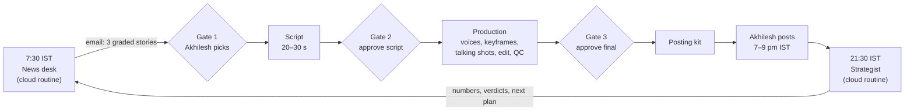

# Doordhan

**An all-AI money channel for Indian working professionals, made by Claude.** Every reel is a 20–30 second clip from a fake 1980s–90s Indian TV channel, in Hinglish (spoken Hindi with the English words people actually use): a Doordarshan-style news bulletin, a loud teleshopping ad, and more to come. The tagline is *"Sab kuch mehnga. Sach muft."* ("Everything's expensive. The truth is free.")

- Instagram: [@doordhan](https://www.instagram.com/doordhan/) · YouTube Shorts: coming soon
- Owner and head writer: Akhilesh. Showrunner, writers' room, production crew and strategist: [Claude Code](https://claude.com/claude-code) (Claude Opus 5.5).

## What this repository is

This is the channel's studio, rulebook and memory. There is no app to run. Claude Code reads this repo at the start of every session and does the work:
- finds the stories;
- writes the scripts;
- makes and checks the videos;
- reads how each reel performed and changes the plan.

People make three decisions per reel, and Akhilesh does all the posting.

Everything Claude learns is written back here, into the formats, playbooks and logs, so the next session starts smarter than the last.

## How a reel gets made



1. **News desk** (every day, 7:30 IST): a scheduled Claude session gathers candidate stories and grades each out of 10.
   - **Sources:**
     - Google Trends India, Google News momentum and YouTube;
     - vidIQ's trending videos and breakout videos in Indian finance;
     - research journalism such as The Ken, SEBI orders and Reuters exclusives.
   - **Grading:** how fast the story is rising, the viewer's stake, how shareable it is, how few good reels exist on it yet, and how clear it is.
   - It emails Akhilesh three options, each with a hook, a fact box with sources, and a posting window.
2. **Gate 1:** Akhilesh replies with a pick, e.g. `2B` (story 2, hook B), from his phone.
3. **Script:** Hinglish, 20–30 seconds. Every number is re-checked against a source.
4. **Gate 2:** Akhilesh or Naveen approves or edits. No money is spent before this.
5. **Production**, in the same cloud session:
   - **Voices:** ElevenLabs voices, over the ElevenLabs API. A character with no ElevenLabs voice yet is voiced through Higgsfield.
   - **Keyframes (the still images each shot starts from):** Higgsfield's image models, GPT Image 2.5 and Seedream 4.5.
   - **Talking shots:** Wan 2.7, which animates the keyframe from our own voice track, so the voice stays exact.
   - **Graphics:** built locally.
   - **Edit:** everything is assembled with a deliberate old-CRT-TV finish (soft SD picture, colour bleed, scanlines, grain, 25 fps, TV-speaker sound).
   - **Automated QC** on every shot:
     - Did the clip keep our audio?
     - Do the lips move?
     - Is the head steady?
     - Does the transcript match the script?
     - Is the loudness right?
6. **Gate 3:** Akhilesh watches the final, with plain-language QC notes and the credits spent. Then he gets a posting kit: caption, hashtags, cover frame, settings, and a YouTube title.
7. **Akhilesh posts.** Claude never publishes anything.
8. **Strategist** (nightly, 21:30 IST): a second scheduled session records every reel's numbers through vidIQ's Instagram insights and judges the current bets. On Sundays it emails a weekly strategy review.

Akhilesh does all of this from the Claude app on his phone. Both routines run in the cloud, so the laptop doesn't need to be on.

**Running it yourself (Akhilesh or Naveen), in a Claude Code session in this repo:**
- `/reel-script <a YouTube or Instagram link, a pasted script, or a topic>`: the script loop (research, independent writers, a judge, cold readers, a draft voice cut of each pick) up to a hand-off with three scripts to choose from. It is the workflow in `.claude/workflows/reel-script.js` with its agents in `.claude/agents/`.
- `/produce-video <the approved script and any edits>`: from the approved script to a QC-stamped final: voice fixes, wardrobe and set, Billu, graphics, keyframes, talking and silent shots, the edit, the old-TV finish, the QC gate, then the registry log and posting kit after approval. It is the skill in `.claude/skills/produce-video/` (with the prompts that worked and the traps we hit); its edit and graphics templates are in `assets/edits/`. Run `python3 pipeline/produce_check.py` once on a new machine first (SETUP.md, "Adding a teammate").

## How we decide what works

We run growth like a trading desk ([docs/strategy.md](docs/strategy.md)):
- Every change is a **bet**, for example "put the hook on screen in the first frame". Each bet has:
  - one number it's judged on, such as the rate of people swiping away in the first 3 seconds;
  - a baseline;
  - a **target**;
  - a **stop loss**.
- A bet is judged after about 3 reels, never on one.
  - **Target hit:** it becomes standard.
  - **Stop hit:** it's cut the same night.
  - **Neither by the limit:** it's closed as "no edge".
- The account has campaign stages with their own targets and a strategy-level stop. If that stop hits, we change strategy rather than tweak.
- `pipeline/scoreboard.py` does the arithmetic. Live numbers are in [registry/performance.md](registry/performance.md), regenerated nightly. The current bets and this week's plan are in [docs/strategy.md](docs/strategy.md).

## The shows

| Show | What it is | Characters |
|---|---|---|
| [Doordhan Samachar](formats/samachar.md) | A poised 1990s news bulletin on today's money story, with a deadpan joke and what it means for the viewer. | **Sarika**, the glamorous anchor (a new outfit every episode), and **Gupta**, the field correspondent. |
| [Abhi Call Karein!](formats/teleshop.md) | A 1990s teleshopping ad selling a financial product live, where the joke is on the seller and the fine print. | **Sachdev**, the presenter, and **Rahul**, the tired caller. |
| [Ideas](formats/ideas.md) | Unbuilt formats: crime re-enactment, a market weather report, an agony aunt, late-night astrology... | |

All characters are AI-generated and labelled as such. New formats follow [formats/_TEMPLATE.md](formats/_TEMPLATE.md).

## The rules that never bend

The full text is in [CLAUDE.md](CLAUDE.md). Only Akhilesh can change these.
1. **Three approval gates:** the story (Akhilesh), and the script and the final video (Akhilesh or Naveen).
2. **Budget:** up to 60 Higgsfield credits per episode, plus 15 a week on experiments. Anything above that needs Akhilesh's approval.
3. **Compliance:** no buy/sell calls and no promised returns (SEBI finfluencer rules). Every caption says "Not investment advice", and AI labels are on every post and on the profile.
4. **Real people:** no real person's likeness, and no cloned voice of a real person.
5. **Secrets:** API keys are never printed, logged or committed.
6. **Publishing:** Claude never publishes. Akhilesh posts.

Platform rules we work inside (Instagram's recommendation guidelines, AI labels, SEBI, India's IT Rules 2026) are in [docs/platform-playbook.md](docs/platform-playbook.md).

## What's where

| Path | What it holds |
|---|---|
| [CLAUDE.md](CLAUDE.md) | Read first. The job, the hard rules, Akhilesh's preferences, and what production has taught us. Claude loads it automatically. |
| [docs/strategy.md](docs/strategy.md) | The strategy book: the rules of the game, the campaign, the current bets, this week's plan and the working rhythm. |
| [docs/](docs/) | The script bible (how to write a reel), learnings from the numbers, the platform and policy playbook, and the research sources. |
| [formats/](formats/) | One file per show: premise, characters, sets, wardrobe, shot pattern, voices and IDs. |
| [playbooks/](playbooks/) | Step-by-step paths for the news desk, script, production and posting kit. They get improved as we learn. |
| [routines/](routines/) | The instructions the two cloud routines read on every run: the morning session and the strategist. |
| [pipeline/](pipeline/) | Python and ffmpeg tools: audio prep, QC checks, the old-TV look, assembly, trend meters and the scoreboard. See [pipeline/README.md](pipeline/README.md). |
| [registry/](registry/) | Every Higgsfield and voice ID, the episode log and lessons, the reel numbers (CSV), the bets, and the performance log. |
| [assets/](assets/) | Reusable stings, logos, title cards and clips. |
| [SETUP.md](SETUP.md) | How everything is wired: repo, connectors, keys, routines, and the day-to-day from the phone. |

Not in the repo on purpose: `outputs/` (finished videos, delivered as links), `work/` (scratch), and `.env` (the ElevenLabs key).

## Services it runs on

| Service | Used for |
|---|---|
| Claude Code (Opus 5.5) | Everything: research, writing, production, QC and strategy. It runs locally in the Claude app and as two cloud routines on claude.ai. |
| Higgsfield (MCP connector) | Image and video generation, and voices for characters with no ElevenLabs voice. Credits are the production budget. |
| ElevenLabs (API key; the MCP connector is the fallback) | Character voices, and transcribing lines for QC. |
| vidIQ (MCP connector) | Trending and breakout videos, keyword research, and @doordhan's Instagram insights. |
| Gmail (MCP connector) | The morning story email, final-video links and the weekly strategy review. |
| GitHub | This repo. Routines clone it, and every episode is committed back. |

The routines and connectors belong to Akhilesh's claude.ai account; [SETUP.md](SETUP.md) has the details.

## Working on it

**To read, discuss or edit** the formats, playbooks, scripts or strategy, no accounts are needed; edit the Markdown. The routines read these files on their next run, so a change to a playbook changes tomorrow's reel. Log meaningful changes in [registry/episodes.md](registry/episodes.md).

**To run the tools locally** (no credits spent):
```bash
brew install ffmpeg          # or: sudo apt-get install -y ffmpeg
pip3 install -r requirements.txt
python3 pipeline/self_test.py   # must end with ALL PASS
python3 pipeline/scoreboard.py  # where the channel stands
```

**To produce a reel yourself**, open this folder in Claude Code with the Higgsfield connector signed in and the ElevenLabs key in `.env` ([SETUP.md](SETUP.md)). `CLAUDE.md` and the playbooks walk it through the rest. Production spends Higgsfield credits, so agree it with Akhilesh first.
