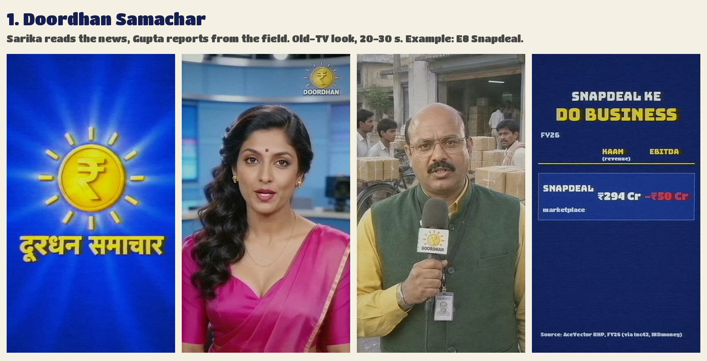
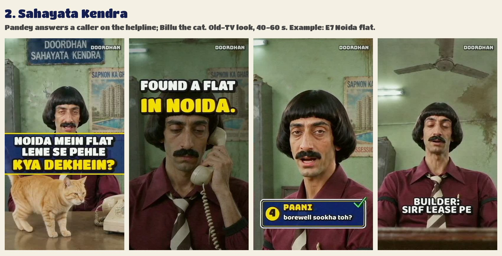
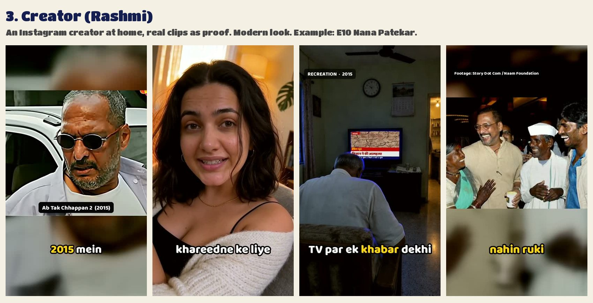
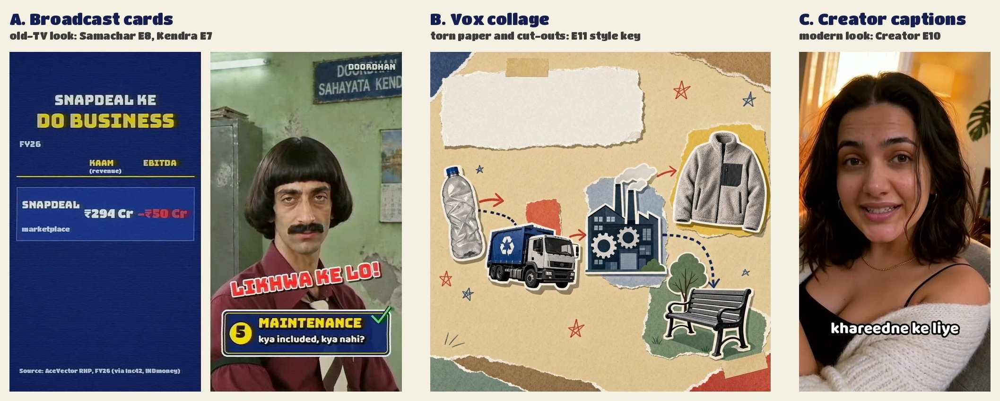

# What we can make: formats and graphics

The `/make-reel` flow shows these pictures when it asks which format and which graphics style a reel gets.
Every frame comes from a reel we made. The flow offers three formats (Akhilesh, 2026-10-20). Teleshop is not on
offer, because Sachdev has no voice now.

## Formats

### 1. Doordhan Samachar

Sarika reads the news in a 90s studio, and Gupta reports from the field. Old-TV look. 20–30 s (about 50–75 words).
Use it for fresh money news: listings, results, SEBI or RBI moves, prices. Rules: formats/samachar.md.

### 2. Sahayata Kendra

Pandey answers a caller on a sleepy government helpline, and Billu the cat watches. Old-TV look. 40–60 s, 70 at most
(about 90–155 words). Use it for a viewer's question with a checklist or a process: "what do I check before ...",
"how much do I need for ...". Rules: formats/sahayata_kendra.md.

### 3. Creator (Rashmi)

Rashmi, an Instagram creator, tells the story from her home, and real clips and photos give the proof. Modern look.
20–30 s (about 50–75 words). Use it for a story about a person or a company, told warmly. Rules: formats/creator.md.

## Graphics styles

| Style | What it is | Made with |
|---|---|---|
| **A. Broadcast cards** | Navy and gold cards, checklists, data tables, lower thirds. Old-TV look. | Samachar (E8), Kendra (E7) |
| **B. Vox collage** | Torn paper, cut-out photos with white borders, marker arrows, stamps, stop-motion. | Creator (E11) |
| **C. Creator captions** | Word-by-word captions with key words in yellow, price stickers, footage labels. Modern look. | Creator (E10) |

Combinations not tried yet (B or C with Samachar or Kendra) are possible as an experiment: they take longer and may
need a test first. The flow says so when someone picks one.

Templates: A is assets/edits/sk03_gfx.py (Kendra) and assets/edits/samachar_gfx.py (Samachar); B is
assets/edits/jio01_vox.py with the paper plates in assets/references/vox/; C is the caption code in
assets/edits/nana01_build.py.
